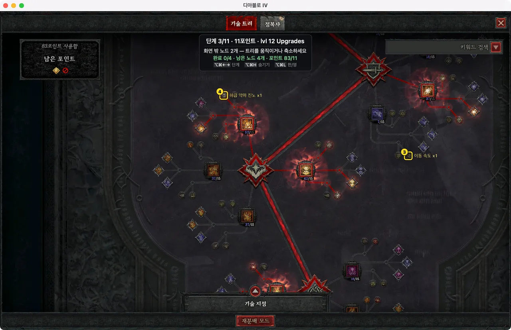
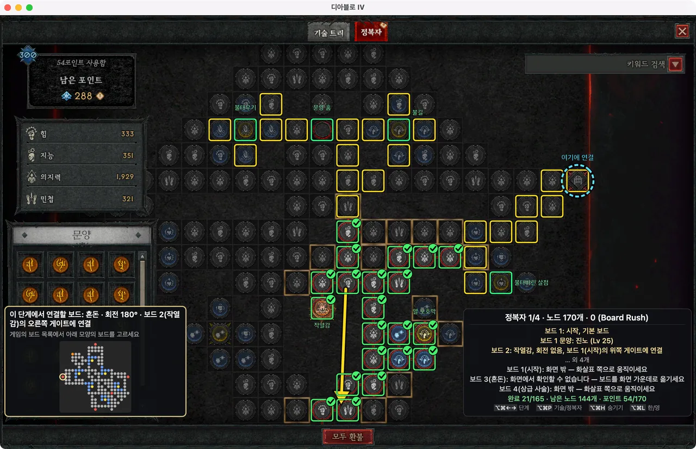
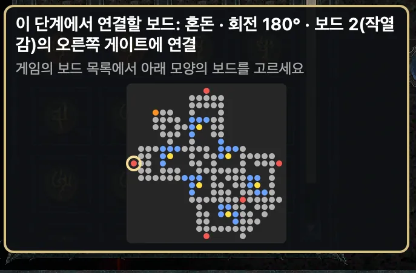
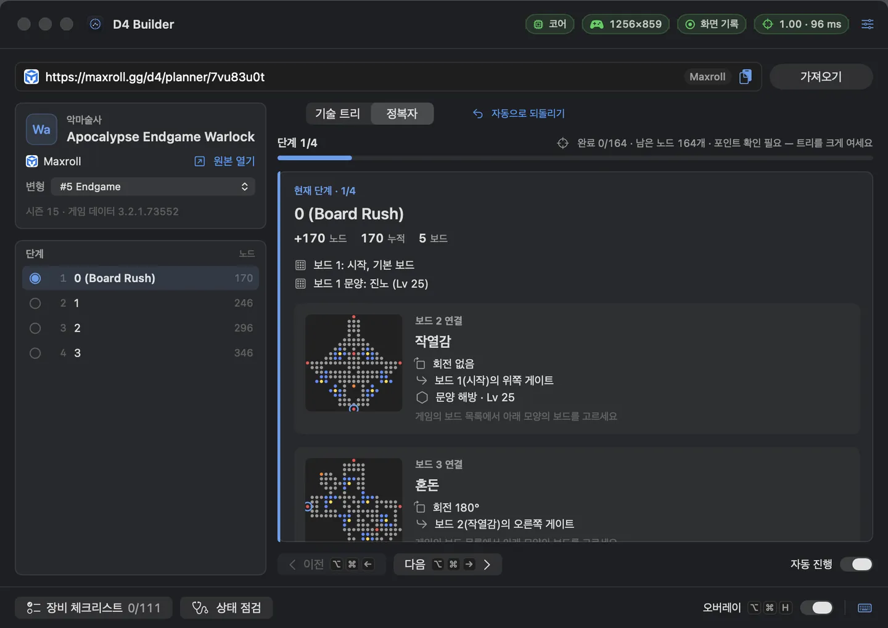
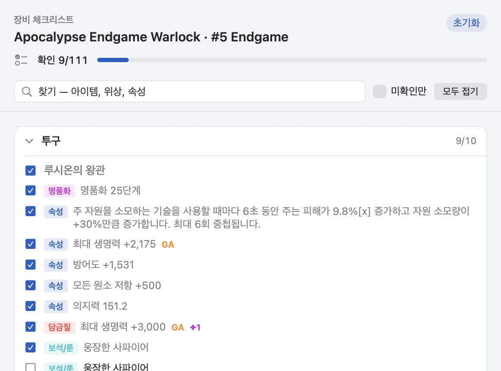
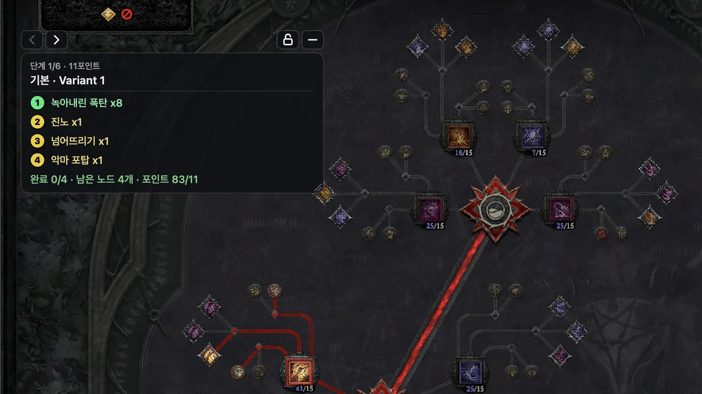
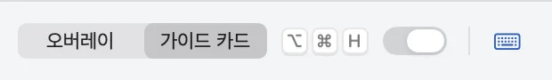
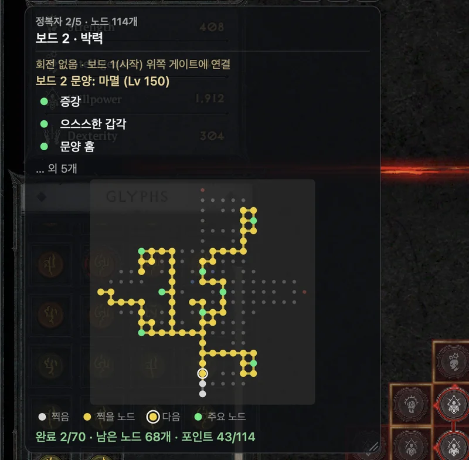
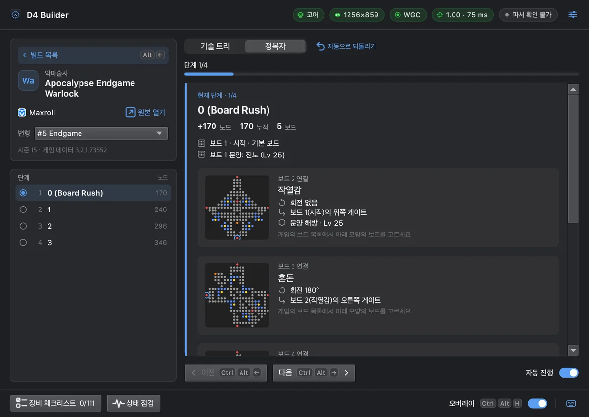

# D4 Builder

[English](README.md) · **한국어**

디아블로 IV 빌드 링크를 붙여 넣으면, 다음에 찍을 스킬과 정복자 노드를 게임 창 위에 바로 표시합니다. 이미 찍은 것을 알아보고 다음 단계로 알아서 넘어갑니다. **macOS**와 **Windows**에서 동작합니다.

이 저장소는 **다운로드와 업데이트 내역**만 올리는 곳입니다. 소스 코드는 없습니다.

- 사이트: https://d4bd.trenddigestnews.com
- 오늘의 인기 빌드: https://d4bd.trenddigestnews.com/builds/
- **다운로드:** [사이트 다운로드](https://d4bd.trenddigestnews.com/#download) · [모든 릴리스](https://github.com/leeyc09/d4-builder/releases) (Mac: `v<버전>`, Windows: `win-v<버전>`)

## 기능

- **기술 트리 안내** — 이번 단계에 찍을 노드를 노란 상자와 순서 번호로, 찍은 노드는 초록 체크로 표시합니다.
- **정복자 안내** — 보드·회전·연결할 게이트, 노드 순서, 화면 밖 방향 화살표, 전설 노드까지 안내합니다.

  

- **가이드 카드** — 게임 창 전체에 그리는 대신 작은 카드 하나로 안내합니다. [아래 설명](#가이드-카드-모드)을 보세요.

- **새 보드 연결 안내** — 붙일 보드와 회전을 카드로 보여 주고, 게임의 보드 미리보기에서 맞는 보드를 골랐는지 알려 줍니다.

  

- **자동 진행** — 게임 화면을 읽어 이번 단계를 다 찍으면 다음 단계로 넘어갑니다.
- **장비 체크리스트** — 빌드의 장비를 슬롯별로 아이템·위상·고유 효과·속성·담금질·보석까지 사이트 표시 그대로 보여 주고, 맞춘 항목을 체크해 둘 수 있습니다.
- **상태 점검** — 권한·게임 창·인식 상태를 한눈에 확인합니다.
- **빌드 출처:** Maxroll · Mobalytics · D4Builds · InfinityBuilds · D2Core.
- 한국어·영어 지원.

| 메인 창 | 장비 체크리스트 |
|---|---|
|  |  |

## 가이드 카드 모드

안내를 보여 주는 방식은 두 가지입니다. 화면 인식과 자동 진행은 같고, 보여 주는 방식만 다릅니다.

| | 오버레이 (기본) | 가이드 카드 |
|---|---|---|
| 표시 위치 | 게임 창 전체에 겹쳐 그림 | 작은 카드 하나 — 게임 위 원하는 자리나 보조 모니터 |
| 노드 표시 | 노드 자리에 노란 상자 · 초록 체크 · 이름표 | 찍을 스킬·노드를 번호 목록으로, 찍으면 ✓ |
| 정복자 안내 | 보드 위에 직접 · 화면 밖 보드는 화살표 | 보드·회전·게이트·문양 + 미니 보드 지도(전체 / 다음 노드 주변 확대) |
| 클릭 | 늘 게임으로 통과 | 잠금을 풀면 카드가 받음(끌기·버튼) · 잠그면 통과 |

**바꾸는 법:** 앱 창 맨 아래 막대의 **오버레이 / 가이드 카드**를 누릅니다(켜기·끄기 스위치 옆). 설정(Mac: 설정 › 표시 방식, Windows: 설정 › 오버레이 › 표시 방식)에서도 고를 수 있고, 바로 적용됩니다.

**카드 다루기**

- 카드를 끌어서 옮기고, 오른쪽 끝을 끌어 폭을 바꿉니다(280–600). 위치·폭·불투명도·잠금은 다음 실행에도 그대로입니다.
- **카드 불투명도** 30–100%로 게임이 비쳐 보이게 할 수 있습니다.
- **카드 잠금**: 자리를 정했으면 잠가 두세요. 클릭이 게임으로 통과하고 버튼 줄이 사라집니다.
- 정복자 단계에서는 카드 아래에 작은 보드 지도와 범례(찍음 · 찍을 노드 · 다음 · 주요 노드)가 붙습니다. 지도 버튼이나 단축키로 보드 전체 ↔ 다음 노드 주변을 번갈아 봅니다.

| 동작 | Mac | Windows |
|---|---|---|
| 다음 · 이전 단계 | ⌥⌘→ · ⌥⌘← | Ctrl+Alt+→ · Ctrl+Alt+← |
| 카드 보이기 · 숨기기 | ⌥⌘H | Ctrl+Alt+H |
| 카드 잠금 · 풀기 | ⌥⌘K | Ctrl+Alt+K |
| 정복자 지도: 전체 ↔ 다음 노드 주변 | ⌥⌘B | Ctrl+Alt+M |

가이드 카드도 게임 화면을 캡처해 읽습니다. 표시 방식만 다를 뿐 동작 방식은 오버레이와 같습니다. 자세한 사용법: [가이드 카드 사용법](https://d4bd.trenddigestnews.com/guide/guide-card/) · [영상](https://www.youtube.com/watch?v=PdxsYOL1HWc)

## 필요한 것

| | macOS | Windows |
|---|---|---|
| 운영체제 | macOS 14 이상, Apple Silicon (인텔 Mac은 확인 안 됨) | Windows 10 (1903 이상) / 11, x64 |
| 게임 화면 | **창 모드**(예: CrossOver). macOS 전체 화면에서는 오버레이가 보이지 않습니다 | **창 모드 전체 화면** 또는 창 모드. 전체 화면(전용)에서는 오버레이가 보이지 않습니다 |
| 권한 | 화면 기록 (시스템 설정 → 개인정보 보호 및 보안 → 화면 및 시스템 오디오 녹음) | 관리자 권한 필요 없음 |

## 설치 — macOS

1. [Releases](https://github.com/leeyc09/d4-builder/releases)에서 최신 `v<버전>`의 `D4-Builder-<버전>-mac.dmg`를 받아 열고, **D4 Builder**를 **응용 프로그램** 폴더로 끌어다 놓습니다. dmg는 꺼내고(추출) 응용 프로그램 폴더에서 실행하세요(dmg 안에서 바로 실행하지 마세요).
2. **처음 실행 — macOS가 두 번 확인합니다.** Apple 공증을 받지 않은 자체 서명 앱이라 아래 순서가 필요합니다.
   1. **D4 Builder**를 엽니다. "확인할 수 없습니다"라는 창이 뜨면 **완료**를 누릅니다(휴지통으로 이동하지 마세요).
   2. **시스템 설정 → 개인정보 보호 및 보안**을 열고 아래쪽 D4 Builder 안내 옆의 **그래도 열기**를 누른 뒤 Mac 암호를 입력합니다.
   3. **D4 Builder**를 다시 엽니다. 확인 창이 한 번 더 뜨면 **그래도 열기**를 한 번 더 누릅니다(암호를 물으면 입력).

   새 버전을 받을 때마다 한 번씩만 필요합니다.
3. **화면 기록** 권한을 허용합니다(시스템 설정 → 개인정보 보호 및 보안 → 화면 및 시스템 오디오 녹음 → D4 Builder 켜기). 허용한 뒤 앱을 종료했다가 다시 엽니다.
4. D4 Builder는 메뉴 막대에 있습니다(Dock 아이콘 없음). 아이콘을 눌러 창을 열고 빌드 링크를 붙여 넣습니다.

내려받은 파일 확인: `shasum -a 256 D4-Builder-<버전>-mac.dmg` 결과를 릴리스에 함께 있는 `.sha256` 파일과 비교하세요.

## 설치 — Windows

1. [Releases](https://github.com/leeyc09/d4-builder/releases)에서 최신 `win-v<버전>`의 `D4Builder-<버전>-win64-setup.exe`를 받아 실행합니다. 관리자 권한 없이 사용자 계정에만 설치됩니다(`%LOCALAPPDATA%\Programs\D4 Builder`).
2. **처음 실행 — Windows SmartScreen:** "Windows의 PC 보호" 창이 뜨면 **추가 정보 → 실행**을 누릅니다. 코드 서명이 없는 앱이라 새 버전마다 나올 수 있습니다.
3. 디아블로 IV **옵션 › 그래픽 › 디스플레이 모드**를 **창 모드 전체 화면**(또는 창 모드)으로 설정합니다.
4. 시작 메뉴의 **D4 Builder**를 실행하고, 알림 영역(트레이) 아이콘에서 창을 열어 빌드 링크를 붙여 넣습니다.

설치 없이 쓰려면 `D4Builder-<버전>-win64.zip`의 압축을 풀고 폴더 안의 `D4Builder.exe`를 실행하세요. 제거: 설정 › 앱 › 설치된 앱 › D4 Builder › 제거(설정과 연결 키는 `%LOCALAPPDATA%\D4Builder`에 남습니다).

내려받은 파일 확인: PowerShell에서 `Get-FileHash -Algorithm SHA256 .\D4Builder-<버전>-win64-setup.exe` 결과를 `.sha256` 파일과 비교하세요.

## 앱 연결

https://d4bd.trenddigestnews.com/account/ 에서 무료로 가입하고(Google·이메일 링크·Battle.net) **앱 연결 키**를 만든 뒤, 앱의 **설정 → 계정 연결**에 붙여 넣습니다. 오버레이는 키를 연결해야 동작하고, 빌드 가져오기와 단계 보기는 키 없이도 됩니다.

## 업데이트

앱이 하루 한 번 새 버전을 확인하고, 있으면 "새 버전" 표시와 업데이트 내역을 보여 줍니다. 새 버전을 받아 설치(Mac은 앱 교체)하면 되고, 설정과 권한은 그대로 이어집니다.

## 안전 설계

D4 Builder는 **화면만 읽는** 프로그램입니다.

- 운영체제 표준 화면 캡처로 게임 창을 읽고, 클릭이 통과되는 창에 그리기만 합니다.
- 마우스·키 입력을 만들지 않고, 게임 메모리를 읽지 않으며, 게임에 코드를 주입하거나 후킹하지 않습니다.
- 자신을 숨기거나 위장하지 않습니다. "D4 Builder"라는 이름 그대로 실행됩니다.

외부 도구의 위험이 0일 수는 없습니다. 사용 책임은 Blizzard 이용 약관에 따라 사용자에게 있습니다.

## 피드백

버그·제안·질문은 앱의 **피드백 보내기…**(Mac: 메뉴 막대 메뉴, Windows: 트레이 메뉴) 또는 https://d4bd.trenddigestnews.com/account/#feedback (로그인 필요)으로 보내 주세요. 진행 상태와 답변은 앱과 계정 페이지에서 볼 수 있습니다. 빌드 가져오기 오류는 **이 오류 알리기**로도 보낼 수 있습니다.

개인정보 처리방침: https://d4bd.trenddigestnews.com/privacy/

## 후원

D4 Builder가 도움이 되셨다면 https://d4bd.trenddigestnews.com/support/ 에서 개발을 응원해 주세요.

## 고지

D4 Builder는 비공식 팬 도구이며 Blizzard Entertainment와 제휴하거나 승인받지 않았습니다. Diablo IV © Blizzard Entertainment, Inc. 빌드 데이터는 각 사이트의 것이며, 앱은 항상 원문 가이드로 연결합니다.
