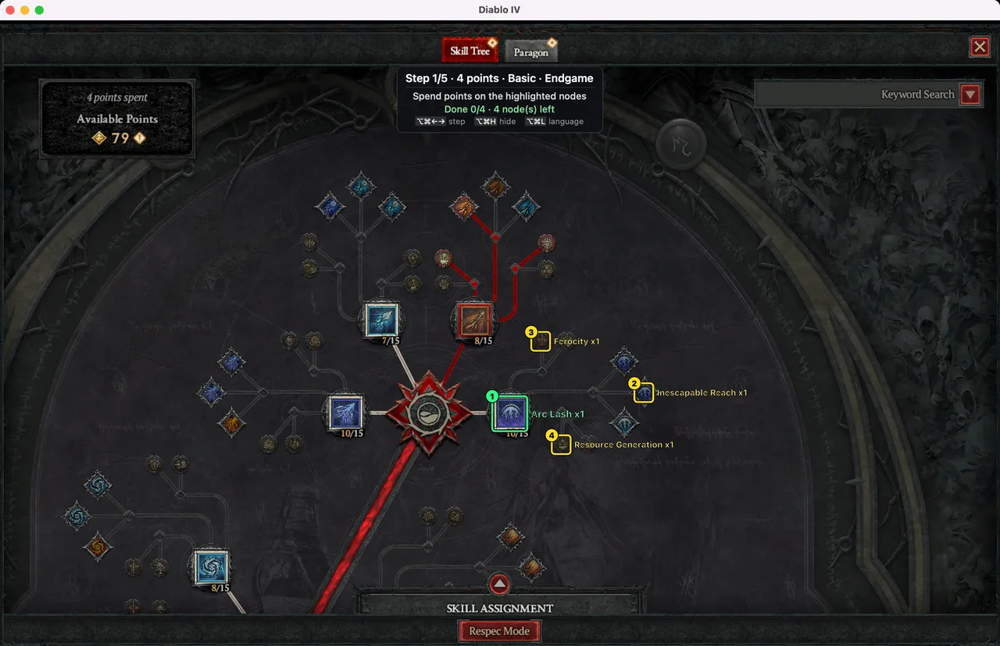
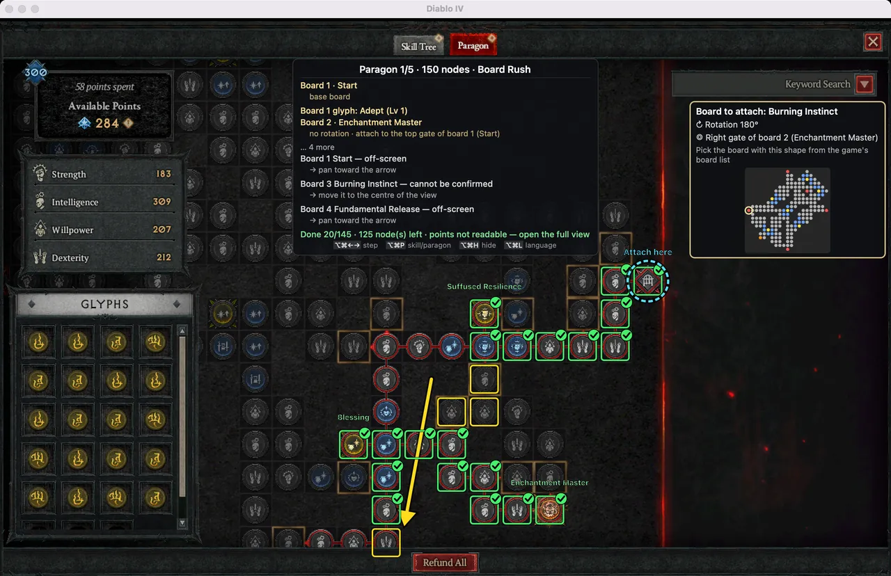
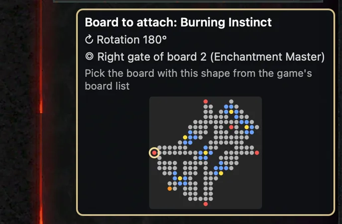
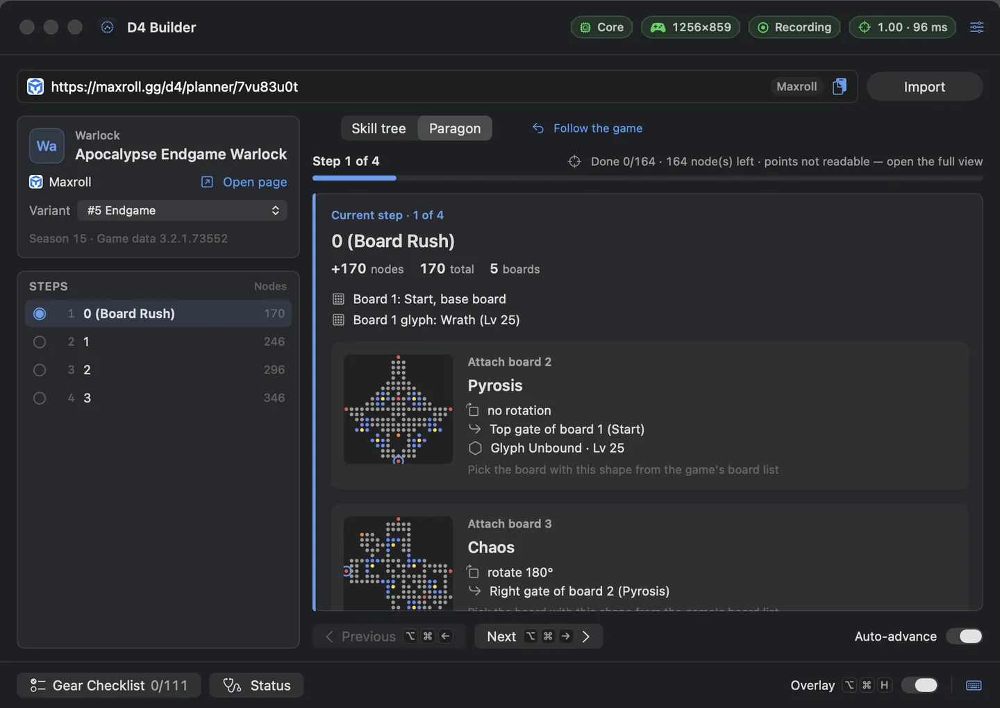
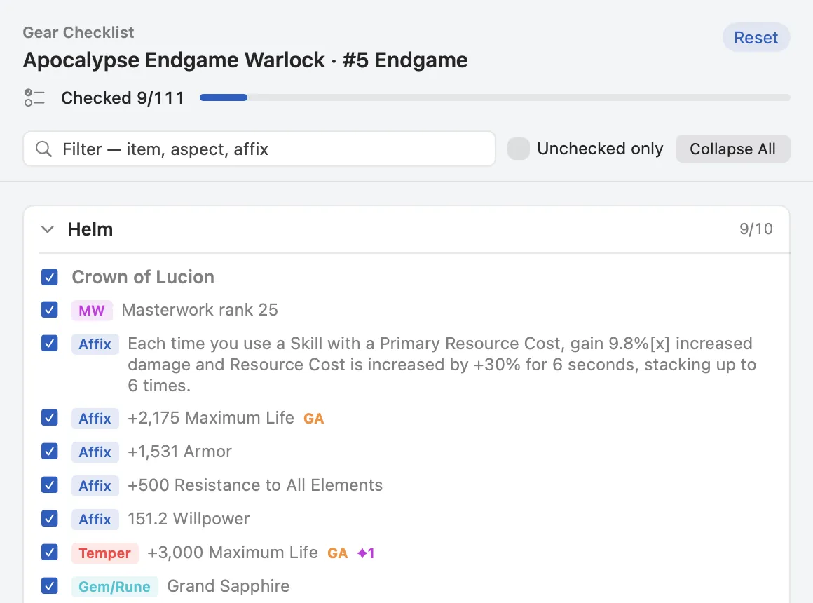
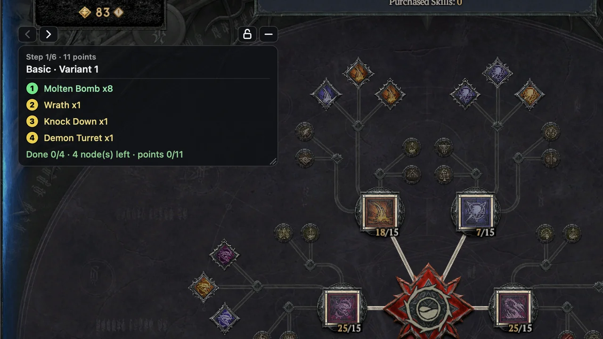
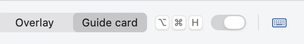
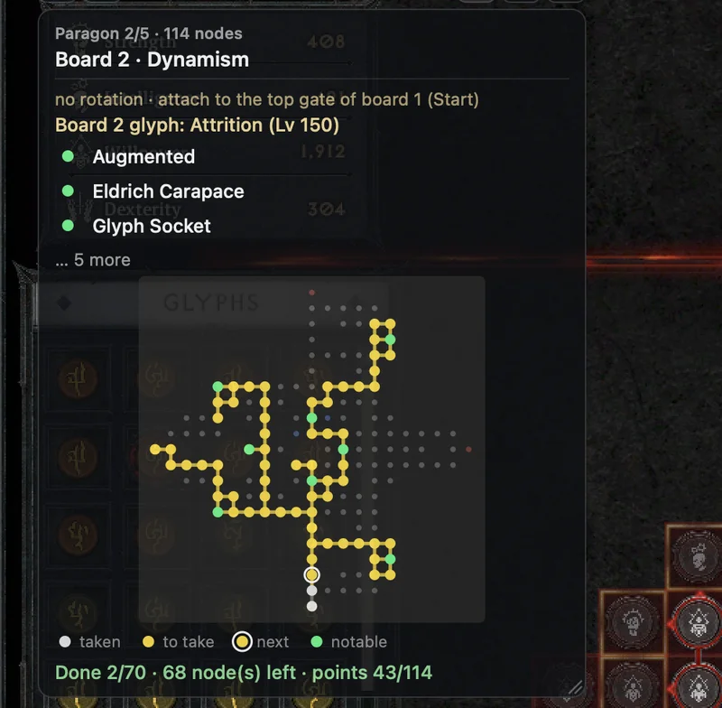
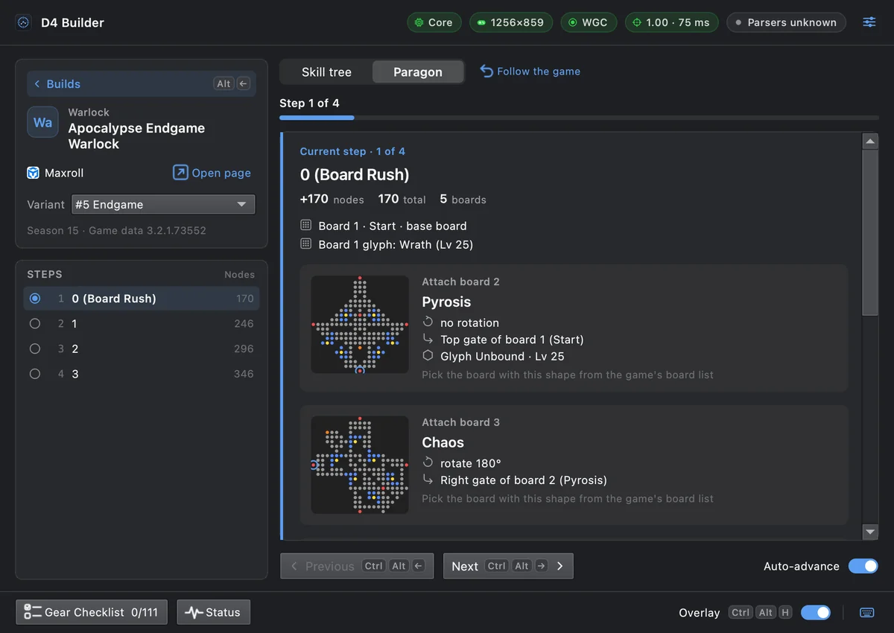

# D4 Builder

**English** · [한국어](README.ko.md)

Paste a Diablo IV build link and D4 Builder shows, right on top of the game window, which skill and which Paragon node to take next. It recognises what you have already allocated and moves to the next step on its own. Runs on **macOS** and **Windows**.

This repository hosts the **downloads and release notes** only. It contains no source code.

- Website: https://d4bd.trenddigestnews.com
- Top builds today: https://d4bd.trenddigestnews.com/builds/
- **Download:** [website download](https://d4bd.trenddigestnews.com/#download) · [all releases](https://github.com/leeyc09/d4-builder/releases) (Mac: `v<version>`, Windows: `win-v<version>`)

## Features

- **Skill tree guide** — yellow boxes and order numbers mark the nodes for this step; nodes you have taken get a green check.
- **Paragon guide** — boards, rotation and the gate to attach to, node order, off-screen arrows, legendary nodes.

  

- **Guide card** — one small card instead of drawing over the whole game window. See [Guide card mode](#guide-card-mode) below.

- **New board guide** — a card shows which board to attach and how to rotate it; in the in-game preview it tells you whether you picked the right board.

  

- **Auto-advance** — reads the game screen and moves to the next step when the current one is done.
- **Gear checklist** — the build's gear slot by slot, as the build site shows it: item, aspect, unique power, affixes, tempers, gems and runes, with check marks you can tick off.
- **Status panel** — permissions, game window and recognition at a glance.
- **Build sources:** Maxroll · Mobalytics · D4Builds · InfinityBuilds · D2Core.
- Korean and English.

| Main window | Gear checklist |
|---|---|
|  |  |

## Guide card mode

The guide can be shown in two ways. Screen recognition and auto-advance are the same; only how the guide is shown differs.

| | Overlay (default) | Guide card |
|---|---|---|
| Where | Drawn over the whole game window | One small card — anywhere over the game or on a second monitor |
| Nodes | Yellow boxes, green checks and labels on the nodes themselves | The skills and nodes to take as a numbered list, ✓ once taken |
| Paragon | Drawn on the board · arrows for off-screen boards | Board, rotation, gate and glyph + a mini board map (whole board / zoomed on the next node) |
| Clicks | Always pass through to the game | The card takes them while unlocked (drag, buttons) · pass through once locked |

**Switching:** click **Overlay / Guide card** in the bar at the bottom of the app window (next to the on/off switch). You can also pick it in Settings (Mac: Settings › Display, Windows: Settings › Overlay › Display). It applies right away.

**Using the card**

- Drag the card to move it; drag its right edge to change the width (280–600). Position, width, opacity and lock are remembered.
- **Card opacity** 30–100% lets the game show through.
- **Lock card**: once it is where you want it, lock it. Clicks pass through to the game and the button row hides.
- In Paragon steps a mini board map with a legend (taken · to take · next · key nodes) sits under the card. The map button or shortcut toggles between the whole board and the area around the next node.

| Action | Mac | Windows |
|---|---|---|
| Next · previous step | ⌥⌘→ · ⌥⌘← | Ctrl+Alt+→ · Ctrl+Alt+← |
| Show · hide the card | ⌥⌘H | Ctrl+Alt+H |
| Lock · unlock the card | ⌥⌘K | Ctrl+Alt+K |
| Paragon map: whole board ↔ around the next node | ⌥⌘B | Ctrl+Alt+M |

The guide card reads the game screen too. Only the display differs; it works the same way as the overlay. More: [Guide card guide](https://d4bd.trenddigestnews.com/guide/en/guide-card/) · [video](https://www.youtube.com/watch?v=sh3S_qt2qRE)

## Requirements

| | macOS | Windows |
|---|---|---|
| OS | macOS 14 or later, Apple Silicon (Intel Macs untested) | Windows 10 (1903 or later) / 11, x64 |
| Game display | **Windowed** (e.g. through CrossOver) — macOS full-screen hides the overlay | **Windowed Fullscreen** or Windowed — exclusive Fullscreen hides the overlay |
| Permission | Screen Recording (System Settings → Privacy & Security → Screen & System Audio Recording) | No administrator rights needed |

## Install — macOS

1. From [Releases](https://github.com/leeyc09/d4-builder/releases), download `D4-Builder-<version>-mac.dmg` of the latest `v<version>`, open it and drag **D4 Builder** into **Applications**. Eject the dmg and launch the app from Applications (not from inside the dmg).
2. **First launch — macOS asks twice.** The app is self-signed (not notarized by Apple), so:
   1. Open **D4 Builder**. macOS says it can't verify the app — click **Done** (do not move it to the Trash).
   2. Go to **System Settings → Privacy & Security**, scroll down to the D4 Builder message and click **Open Anyway**, then enter your Mac password.
   3. Open **D4 Builder** again. A second dialog appears — click **Open Anyway** once more (and enter your password if asked).

   This is needed only once per downloaded version.
3. Allow **Screen Recording** (System Settings → Privacy & Security → Screen & System Audio Recording → turn on D4 Builder), then quit and reopen the app.
4. D4 Builder lives in the menu bar (no Dock icon). Click its icon to open the window and paste a build link.

To verify a download: `shasum -a 256 D4-Builder-<version>-mac.dmg` and compare with the `.sha256` file attached to the release.

## Install — Windows

1. From [Releases](https://github.com/leeyc09/d4-builder/releases), download and run `D4Builder-<version>-win64-setup.exe` of the latest `win-v<version>`. It needs no administrator rights and installs for your account only (`%LOCALAPPDATA%\Programs\D4 Builder`).
2. **First launch — Windows SmartScreen:** on "Windows protected your PC" click **More info → Run anyway**. The app is not code-signed, so this can appear for each new version.
3. In Diablo IV set **Options › Graphics › Display Mode** to **Windowed Fullscreen** (or Windowed).
4. Start **D4 Builder** from the Start menu, open the window from the notification-area (tray) icon and paste a build link.

Portable: unzip `D4Builder-<version>-win64.zip` and run `D4Builder.exe` inside the folder. Uninstall: Settings › Apps › Installed apps › D4 Builder › Uninstall (your settings and connection key stay in `%LOCALAPPDATA%\D4Builder`).

To verify a download: in PowerShell run `Get-FileHash -Algorithm SHA256 .\D4Builder-<version>-win64-setup.exe` and compare with the `.sha256` file.

## Link the app

Sign up for free at https://d4bd.trenddigestnews.com/account/ (Google, email link or Battle.net), create an **app connection key**, and paste it into the app's **Settings → Account**. The overlay needs a linked key; importing builds and browsing steps work without one.

## Updates

The app checks for new versions once a day and shows a "new version" chip with release notes. Install the new version (on the Mac, replace the app); your settings and permissions carry over.

## Safety

D4 Builder is **read-only**:

- It only reads the game window with the operating system's standard screen capture and draws on a click-through window.
- It never sends mouse or keyboard input, never reads game memory, never injects code or hooks into the game.
- It does not hide or disguise itself; it runs as "D4 Builder".

No third-party tool is risk-free. Using one is your own responsibility under Blizzard's Terms of Use.

## Feedback

Bug reports, ideas and questions: **Send feedback…** in the app (Mac: the menu-bar menu, Windows: the tray menu), or https://d4bd.trenddigestnews.com/account/#feedback (sign-in required). You can follow the status and replies in the app and on your account page. Import errors can also be sent with **Report this error**.

Privacy policy: https://d4bd.trenddigestnews.com/privacy/

## Support

If D4 Builder helps you, you can support its development at https://d4bd.trenddigestnews.com/support/en/.

## Disclaimer

D4 Builder is an unofficial fan tool, not affiliated with or endorsed by Blizzard Entertainment. Diablo IV © Blizzard Entertainment, Inc. Build data belongs to each source site; the app always links to the original guide.
